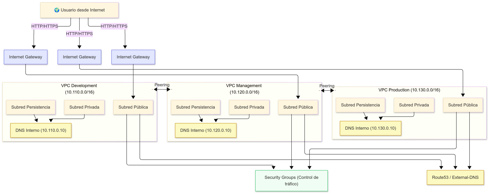

import Zoom from "react-medium-image-zoom";

# Network Resources

This documentation provides a clear and simple overview of the network architecture that SleakOps deploys in client environments. It explains how the network is organized, how resources are protected, and how both internal and external communication is managed.

> ❓ **Note:** The network is designed to ensure security, scalability, and high availability. It enables environment separation, protects sensitive data, and exposes services in a secure and controlled way.

## 1. Overview of the Architecture

The SleakOps network infrastructure is based on the following key components:

- **VPC (Virtual Private Cloud):** Segregates networks by environment (Management, Production, Development).
- **Subnets:**
  - *Public:* exposed to the Internet.
  - *Private:* restricted access, Internet access via NAT Gateway.
  - *Persistence:* for databases and storage.
- **Internet Gateway:** Enables communication between the VPC and the Internet.
- **Route Tables:** Define routing paths between subnets and to/from the Internet.
- **Security Groups:** Virtual firewalls that control inbound and outbound traffic for resources.
- **Internal DNS:** Allows internal resources to communicate using hostnames instead of IP addresses.
- **External-DNS:** Runs inside each Kubernetes (EKS) cluster and automatically manages public DNS records in Route53 for exposed services.

## 2. Typical Communication Flow

The following illustrates a typical flow of network traffic in SleakOps:

1. **Access from the Internet:**  
   A user accesses a publicly exposed service (e.g., an API). Traffic reaches the Internet Gateway and is routed to the public subnet.

2. **Access Control:**  
   The Security Group associated with the resource evaluates whether the connection is allowed.

3. **Internal Communication:**  
   Internal services (in private or persistence subnets) communicate using internal DNS, under Security Group rules.

4. **Service Exposure:**  
   If a service within a Kubernetes cluster needs to be publicly accessible (e.g., an API), it is exposed via an Application Load Balancer, and External-DNS registers the public domain automatically in Route53.

> This segmentation and control ensure that only necessary services are exposed while keeping sensitive data protected.

<Zoom overlayBgColorEnd="rgba(255, 255, 255, 0.8)">
  
</Zoom>

## 3. External-DNS and Route53

An automated solution is used to manage public DNS records for deployed services, integrating the infrastructure with external DNS providers like Route53.

- External-DNS **does not expose services directly**. It automates DNS record management for resources that are already exposed (e.g., via an Application Load Balancer).
- This allows services to be securely and easily accessible from the Internet.

## 4. Cross-Environment Connectivity via VPC Peering

To enable controlled communication between environments (e.g., between Management and Production), SleakOps sets up **VPC Peering connections** between the different VPCs.

- **VPC Peering** enables two VPCs to exchange internal traffic as if they were part of the same network.
- **It does not require** Internet, NAT Gateway, or VPN traffic routing.
- It is a direct connection between two networks.

> 💡 Besides Internet Gateway access, SleakOps also supports other connectivity options such as **Pritunl VPN**, **NAT Gateway**, and **Transit Gateway**, depending on use case and required isolation level.

## 5. VPC Flow Logs

VPC Flow Logs record the IP traffic of the VPC of an AWS account: source and destination addresses, ports, protocol, and whether the traffic was accepted or rejected. They do not record packet contents. Use them to audit connections, investigate rejected traffic, or confirm which resources talk to each other.

VPC Flow Logs are off by default. Users with the **Admin** role turn them on per account from **Providers** → **Accounts & Networking**, in the **VPC Flow Logs** section of the account. The section appears once the account has its network set up. Imported VPCs are supported, and any flow logs you already have on the VPC are not changed.

| **Option**    | **Values**                                               |
| ------------- | -------------------------------------------------------- |
| **Traffic**   | All (default), Accepted only, Rejected only              |
| **Retention** | 30, 90 (default), 180 or 365 days                        |

### Where the logs are stored

Logs are written to a private, encrypted Amazon S3 bucket in the same AWS account, named `sleakops-<aws-account-id>-<region>-vpc-flow-logs`. Files are in Parquet format, partitioned by hour. They are deleted from the bucket when the retention period ends. The console shows the status, the configuration and the bucket name; it does not display the logs.

### Query the logs

Download the files from the S3 bucket, or query them with Amazon Athena. For example, to list the most rejected destination ports, run the following statements one at a time, separately:

```sql
CREATE EXTERNAL TABLE vpc_flow_logs (
  version int, account_id string, interface_id string,
  srcaddr string, dstaddr string, srcport int, dstport int,
  protocol bigint, packets bigint, bytes bigint,
  `start` bigint, `end` bigint, action string, log_status string,
  vpc_id string, subnet_id string, instance_id string,
  tcp_flags int, type string, pkt_srcaddr string, pkt_dstaddr string,
  flow_direction string, traffic_path int
)
PARTITIONED BY (
  `aws-account-id` string, `aws-service` string, `aws-region` string,
  year string, month string, day string, hour string
)
STORED AS PARQUET
LOCATION 's3://sleakops-<aws-account-id>-<region>-vpc-flow-logs/AWSLogs/';

MSCK REPAIR TABLE vpc_flow_logs;

SELECT dstport, count(*) AS rejected
FROM vpc_flow_logs
WHERE action = 'REJECT' AND year = '2026' AND month = '11'
GROUP BY dstport
ORDER BY rejected DESC
LIMIT 10;
```

Run `MSCK REPAIR TABLE` again to load the partitions of new hours.

### Cost

AWS charges for VPC Flow Logs on your own AWS account, not through SleakOps. List prices in us-east-1:

| **Concept**                         | **Price**               |
| ----------------------------------- | ----------------------- |
| Delivery to S3                      | US$0.25 per GB          |
| Conversion to Parquet               | US$0.03 per GB          |
| S3 Standard storage                 | US$0.023 per GB-month   |

A small account typically pays from a few cents to a few dollars per month; the cost grows with the traffic of the VPC. Choosing **Rejected only** reduces the volume considerably.

### Turn off or delete

Turning VPC Flow Logs off stops recording; the logs already written stay in the bucket until the retention period ends. Deleting the account keeps the bucket and its logs in your AWS account; they expire according to the retention you set.
