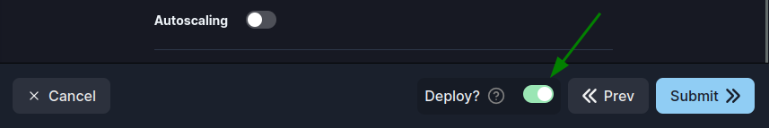
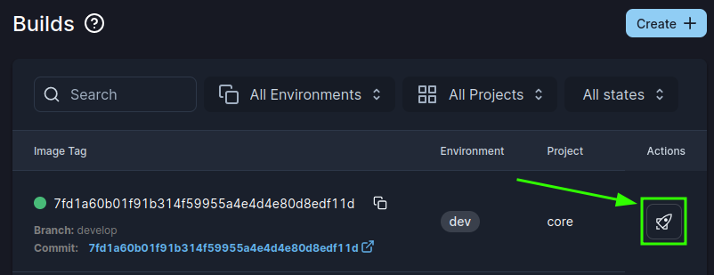

import Zoom from 'react-medium-image-zoom';
import 'react-medium-image-zoom/dist/styles.css';

# Deployment

A Deployment in Sleakops signifies the installation of a new version of your application. This involves three primary components, together forming a Helm Release:
- [Releases](/docs/project/deployment/release): These are versioned combinations of your [Workloads](/docs/project/workload) including WebServices, Workers, CronJobs, and Hooks.
- Build Image: Represented by a [Build](/docs/project/build).
- Configuration Values: These comprise resources like [Volumes](/docs/project/volumes) and [VariableGroups](/docs/project/vargroup).

:::info

When there's an update to any of these resources that wasn't deployed immediately, SleakOps queues it as a [pending change](/docs/project/deployment/pending_changes) and shows a **Publish** badge on the environment.

:::

## Deploying your ProjectEnv

Upon creating a Deployment, we fetch the image corresponding to the Build to be deployed. Before this, we execute the Helm Release in the appropriate cluster namespace. This Helm release includes necessary Kubernetes services, ingresses, workers, and other services.

Various methods exist to generate a Deployment. These are outlined below. Note that we force certain Deployments. For details, refer to [More on Deployment](/docs/project/deployment/more_on_deployment#forced-deployments).

- [Workloads](/docs/project/workload): Provides a switcher allowing you to decide whether to run a new Deployment.
- [VariableGroup](/docs/project/vargroup): Operates similarly to Workloads but doesn't create a new Release. Instead, it only updates the [values](https://helm.sh/docs/chart_best_practices/values/) of the Deployment.
- [Dependency](/docs/project/dependency): Triggers a Deployment automatically. Delve deeper into this at [More on Deployment](/docs/project/deployment/more_on_deployment).

<Zoom overlayBgColorEnd="rgba(255, 255, 255, 0.8)">
  
</Zoom>

### Manual Deployment

If you skip deploying your changes immediately, or if your modification doesn't enforces a deployment, you have three methods to execute a Deployment:

- [Build section](/docs/project/build): Utilizing the Deploy button, you can determine which Build to deploy.
<Zoom overlayBgColorEnd="rgba(255, 255, 255, 0.8)">
  
</Zoom>

#### Pending changes

- **Publish badge**: environments with content pending that was not yet deployed on the cluster show a **Publish** badge in the Projects list, the Project dashboard and the Deployments list. Clicking it opens the pending deployment's detail, where you review the accumulated changes and publish them. See [Pending Changes & Publishing](/docs/project/deployment/pending_changes).

- Via the [CLI ](/docs/cli).

## Cancelling a Deployment

Use **Cancel Deploy**, in the Deployments list or in the deployment's detail, to stop a deployment that is queued (**Initial**) or in progress (**Creating**). Viewers can't cancel deployments.

- **Queued**: the deployment is removed before it reaches the cluster.
- **In progress**: a confirmation asks you to confirm with **Cancel deployment**. Cancelling can't guarantee that hooks haven't already run or that the version isn't already applied in the cluster, so SleakOps checks the cluster before deciding the final state:
  - If the deploy already finished successfully, it ends as **Created**.
  - Otherwise it ends in **Error**, with a message starting with "Cancelled by user" that says what happened: the deploy had already failed, its result couldn't be confirmed, or it was stopped while running and the release was rolled back to its previous version. A first deployment has no previous version, so it is stopped without a rollback.

In every case, the deployments queued behind the cancelled one continue.
