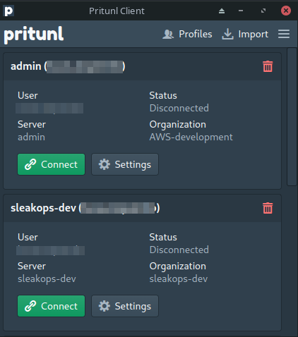
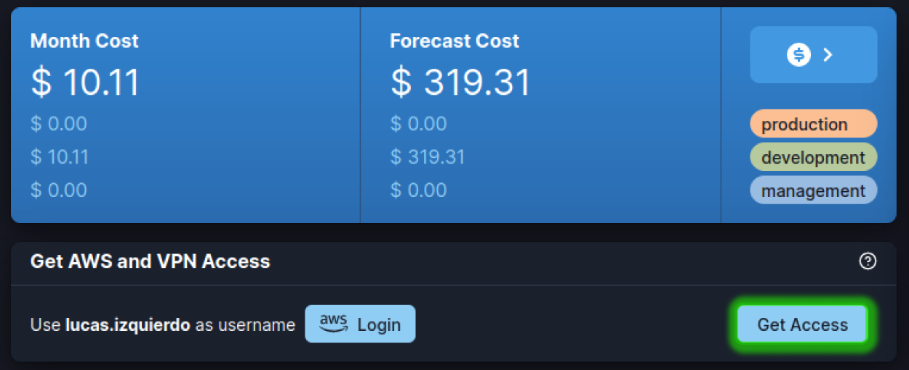
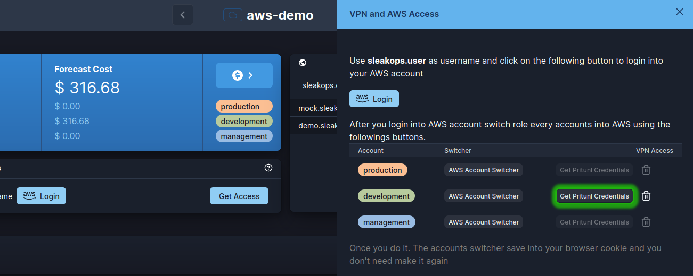
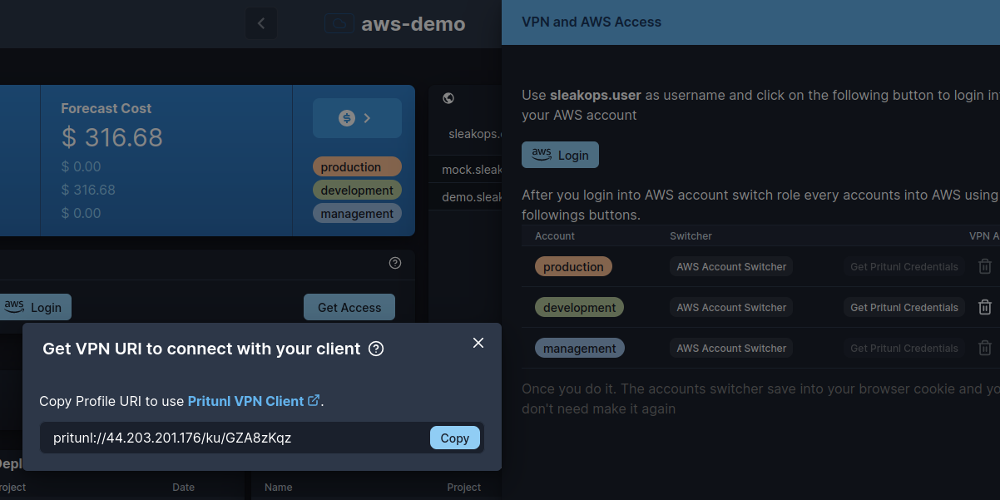
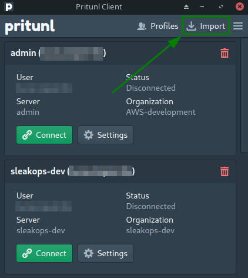

import Zoom from "react-medium-image-zoom";
import "react-medium-image-zoom/dist/styles.css";
import { FiExternalLink } from "react-icons/fi";

# Connect into the VPN

To handle VPN connections we use Pritunl. You can download the client [here](https://client.pritunl.com/#install).

<Zoom overlayBgColorEnd="rgba(255, 255, 255, 0.8)">
  
</Zoom>

Once you've created a [Provider ](/docs/provider), go to [SleakOps dashboard](https://console.sleakops.com/) and select the account for which you want to get VPN access. Remember, to do this, you need to have access to the VPN of that account, but the VPN must also be created. We create the VPN of a specific account when the first cluster of that account is created. 

<Zoom overlayBgColorEnd="rgba(255, 255, 255, 0.8)">
  
</Zoom>

<Zoom overlayBgColorEnd="rgba(255, 255, 255, 0.8)">
  
</Zoom>

This will prompt you with what is called the URI profile. It has a validation period of 24 hours, and you must load it into the Pritunl client.

<Zoom overlayBgColorEnd="rgba(255, 255, 255, 0.8)">
  
</Zoom>

Copy it and import it into the Pritunl client, and you'll be able to connect to it:

<Zoom overlayBgColorEnd="rgba(255, 255, 255, 0.8)">
  
</Zoom>

<Zoom overlayBgColorEnd="rgba(255, 255, 255, 0.8)">
  
</Zoom>

<Zoom overlayBgColorEnd="rgba(255, 255, 255, 0.8)">
  
</Zoom>

:::tip
If your account uses the new VPN (V2) and the Pritunl client can't import the profile, the network you are on may not be allowed to reach the VPN server. An admin can allow it in **Allowed IPs for port 443** (see below).
:::

## Configure your VPN

Admins can change how the VPN of each account works from the account's **VPN settings** page. Open it from any of these places:

- **Providers** → the provider's **Accounts & Networking** → **VPN settings** on the account.
- The **VPN server** node in the account's network diagram, on the same page.
- **Manage VPN settings for this account**, in the VPN step of a Cluster's access page.

Only admins can open this page.

These settings are available with the new VPN (V2), and the **VPN settings** button only appears on accounts that have it. New accounts get it from the start. If an account still runs the previous VPN, run the migration **VPN V2: Improved Reliability, Security and Management** from **Upgrades**. It creates the new VPN alongside the current one, so nobody loses access while you switch. After it runs, every VPN user downloads and imports the new profile. The migration also copies the settings and the routes you changed in the previous VPN to the new one. If the copy fails, it tells you and the new VPN keeps its default settings, so review them in **VPN settings**. Routes to the networks of your other accounts are not copied: the migration tells you which ones it left out, and you can add them in **VPN settings** if users need them. A later upgrade, **VPN V2: Retire the Previous VPN Server**, removes the previous server: profiles created before it stop working.

### Server settings

The form shows the settings most accounts change: **DNS servers** (between 1 and 4, in order of preference), **Search domain**, **Traffic between users**, **Require a one-time code (MFA)**, **Max connected users**, **Several devices per user**, **Max devices per user**, **Session timeout (seconds)**, **Inactive timeout (seconds)** and **Message before connecting**. Each field shows its allowed range below it.

### Advanced (JSON)

The **Advanced (JSON)** section shows every editable server setting as JSON, like the server editor of Pritunl, so you can change the ones the form doesn't show: **DNS mapping**, **Block outside DNS**, **Restrict routes**, **MSS fix**, **Jumbo frames**, **LZO compression**, **IPv6**, **IPv6 firewall**, the ping settings (**Ping interval**, **Ping timeout**, **Link ping interval** and **Link ping timeout**), **Allowed devices**, **Encryption cipher**, **Hash algorithm** and **Debug logging**. It also lists the other settings of the Pritunl server that SleakOps has no form for, such as **route_dns** or **geo_sort**. SleakOps checks that each new value has the same type as the current one.

Edit the JSON and click **Apply JSON**. The values go into the form and nothing changes on the VPN until you click **Save server and routes**. If a value is not valid, or the JSON includes a setting that can't be changed, SleakOps lists what is wrong and applies nothing. **Ping timeout** must be at least the ping interval plus 5.

SleakOps can't tell whether one of those other Pritunl settings changes the VPN profiles. Before you save one, check it in the Pritunl documentation: SleakOps asks you to confirm that you did, and if it does affect the profiles, every user has to import theirs again. Settings that SleakOps manages, and the ones that only report the server's state, are not editable.

Values listed under **Managed by SleakOps** are shown for reference and can't be changed: **Client network**, **Port**, **Protocol**, **Network mode**, **VXLAN**, **Groups**, **DH parameter size (bits)**, **WireGuard** and **Replicas**.

:::warning Every user imports their profile again
**Encryption cipher**, **Hash algorithm**, **IPv6**, **IPv6 firewall** and **Allowed devices** are part of each user's VPN profile. When you change one of them, SleakOps asks you to confirm that every user must import their profile again: until they do, their current profile may not connect.
:::

The Pritunl administrator credentials are never shown in SleakOps. They are stored in AWS Secrets Manager, in the account itself, in the secret whose name contains `pritunl-v2-secret`.

### Routes

Routes are the networks VPN users can reach. You can add a network (IPv4 in CIDR notation, e.g. `192.168.50.0/24`), remove it, and turn **NAT** on or off for it. Turn on NAT when the destination network has no route back to VPN clients. A default route (`0.0.0.0/0`) is not allowed.

Routes marked **Managed** can't be changed or removed: they cover the account's own network, the VPN client network and the DNS servers. To change the DNS routes, change the **DNS servers**. A new VPN only reaches the account's own network. Add the networks of other accounts or your own networks if users need them. This also applies to the **Management Account**: its network is connected to your other accounts, but its VPN only reaches them after you add their networks here.

:::warning
**Save server and routes** restarts the VPN server once. Connected users are disconnected for about a minute and their Pritunl client reconnects on its own. The outage lasts about as long as the **Ping timeout** (60 seconds by default): a lower value shortens it.
:::

### Allowed IPs for port 443

Port 443 of the VPN server is closed by default, except to SleakOps. Add the IP ranges of the people who import their profile from the link, because their Pritunl client downloads it from this port. Once connected to the VPN, the web interface is available at the VPN's private address, so it needs no ranges. Use `0.0.0.0/0` only to open it to everyone. Saving this does not disconnect anyone.

Enter the ranges in **Allowed ranges** (IPv4 in CIDR notation, e.g. `203.0.113.0/24`) and click **Save allowed IPs**. The change takes a minute or two to apply.
