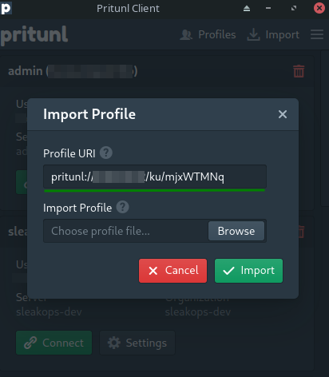
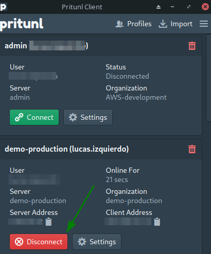

import Zoom from "react-medium-image-zoom";
import "react-medium-image-zoom/dist/styles.css";
import { FiExternalLink } from "react-icons/fi";

# Connect into the VPN

To handle VPN connections we use Pritunl. You can download the client [here](https://client.pritunl.com/#install).

<Zoom overlayBgColorEnd="rgba(255, 255, 255, 0.8)">
  
</Zoom>

Once you've created a [Provider ](/docs/provider), go to [SleakOps dashboard](https://console.sleakops.com/) and select the account for which you want to get VPN access. Remember, to do this, you need to have access to the VPN of that account, but the VPN must also be created. We create the VPN of a specific account when the first cluster of that account is created. 

<Zoom overlayBgColorEnd="rgba(255, 255, 255, 0.8)">
  
</Zoom>

<Zoom overlayBgColorEnd="rgba(255, 255, 255, 0.8)">
  
</Zoom>

This will prompt you with what is called the URI profile. It has a validation period of 24 hours, and you must load it into the Pritunl client.

<Zoom overlayBgColorEnd="rgba(255, 255, 255, 0.8)">
  
</Zoom>

Copy it and import it into the Pritunl client, and you'll be able to connect to it:

<Zoom overlayBgColorEnd="rgba(255, 255, 255, 0.8)">
  
</Zoom>

<Zoom overlayBgColorEnd="rgba(255, 255, 255, 0.8)">
  
</Zoom>

<Zoom overlayBgColorEnd="rgba(255, 255, 255, 0.8)">
  
</Zoom>

:::tip
If your account uses the new VPN (V2) and the Pritunl client can't import the profile, its network may not be allowed to reach the VPN server. An admin can allow it in **Allowed IPs for importing VPN profiles** (see below).
:::

## Configure your VPN

Admins can change how the VPN of each account works. Go to **Providers**, open the provider's **Accounts & Networking** and click **VPN settings** on the account. Admins also find a **Manage VPN settings for this account** link in the VPN step of a Cluster's access page.

These settings are available with the new VPN (V2). Accounts created now get it from the start. If an account still runs the previous VPN, the panel shows a notice: run the migration **VPN V2: Improved Reliability, Security and Management** from **Upgrades**. It creates the new VPN alongside the current one, so nobody loses access while you switch. After it runs, every VPN user downloads and imports the new profile. A later upgrade, **VPN V2: Retire the Previous VPN Server**, removes the previous server: profiles created before it stop working.

### Server

| **Setting** | **Description** |
| --- | --- |
| **DNS servers** | Resolvers pushed to VPN clients, in order of preference. You can set between 1 and 4. |
| **Require a one-time code (MFA) to connect** | Users must enter a one-time code each time they connect. |
| **Inactive timeout (seconds)** | Disconnects idle users. `0` keeps them connected. |
| **Max devices per user** | How many devices each user can connect at once. `0` means no limit. |
| **Search domain** (Advanced) | Appended to short host names, so users can reach `db` instead of `db.internal`. |
| **Session timeout (seconds)** (Advanced) | Ends every session after this long, active or not. `0` means no limit. |
| **MSS fix** (Advanced) | Caps the TCP segment size to avoid stalled connections on networks with a small MTU. Leave it empty unless you see that problem. |

The server port is managed by SleakOps and can't be changed.

### Routes

Routes are the networks VPN users can reach. You can add a network (IPv4 in CIDR notation, e.g. `192.168.50.0/24`), remove it, and turn **NAT** on or off for it. Turn on NAT when the destination network has no route back to VPN clients. Routes marked **Managed** give VPN users access to the account's network: SleakOps maintains them, so they can't be changed or removed.

:::warning
**Save server and routes** restarts the VPN server once. Connected users are disconnected for a few seconds and their Pritunl client reconnects on its own.
:::

### Allowed IPs for importing VPN profiles

By default only SleakOps can reach port 443 of the VPN server, and each user's Pritunl client needs to reach it to import their profile. Add your office ranges in **Allowed ranges** (IPv4 in CIDR notation, e.g. `203.0.113.0/24`), or `0.0.0.0/0` to open it to everyone. The VPN connection itself does not use this port.

**Save allowed IPs** does not disconnect anyone. The change takes a few minutes to apply.
