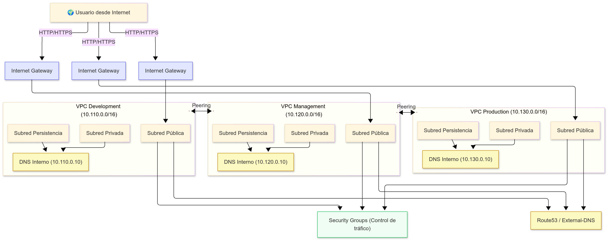

import Zoom from "react-medium-image-zoom";

# Networking y Recursos de Red

Esta documentación tiene como objetivo brindar una visión clara y sencilla de la arquitectura de red que SleakOps despliega en los entornos de los clientes. Aquí encontrarás cómo se organiza la red, cómo se protegen los recursos y cómo se facilita la comunicación tanto interna como externa.

> ❓ **Nota**: La red está diseñada para garantizar seguridad, escalabilidad y alta disponibilidad. Permite separar ambientes, proteger datos sensibles y exponer servicios de manera controlada y segura.

## 1. Descripción general de la arquitectura

La infraestructura de red en SleakOps se basa en los siguientes componentes principales:

- **VPC (Virtual Private Cloud):** Segmenta la red por entorno (Management, Production, Development).
- **Subredes:**
  - *Públicas:* expuestas a Internet.
  - *Privadas:* acceso restringido, acceden a Internet a través de un NAT Gateway.
  - *Persistencia:* bases de datos, almacenamiento.
- **Internet Gateway:** Permite la comunicación entre la VPC y el exterior (Internet).
- **Route Tables:** Definen las rutas de tráfico entre subredes y hacia/desde Internet.
- **Security Groups:** Firewalls virtuales que controlan el tráfico de entrada y salida de los recursos.
- **DNS Interno:** Permite que los recursos se comuniquen usando nombres en vez de IPs.
- **External-DNS:** Servicio que corre dentro de cada clúster Kubernetes (EKS), encargado de gestionar automáticamente los registros DNS públicos en Route53 para los servicios expuestos desde el clúster.

## 2. Flujo típico de comunicación

El siguiente es un ejemplo de cómo viaja el tráfico en la red de SleakOps:

1. **Acceso desde Internet:**  
   Un usuario accede a un servicio expuesto (por ejemplo, una API). El tráfico llega al Internet Gateway y es dirigido a la subred pública.

2. **Control de acceso:**  
   El Security Group asociado al recurso valida si la conexión está permitida.

3. **Comunicación interna:**  
   Los servicios internos (en subredes privadas o de persistencia) pueden comunicarse entre sí usando el DNS interno, siempre bajo las reglas de los Security Groups.

4. **Exposición de servicios:**  
   Si un servicio dentro del clúster Kubernetes debe ser accesible desde Internet (por ejemplo, una API), se expone a través de un Application Load Balancer y External-DNS se encarga de registrar automáticamente el nombre en Route53.

> Esta segmentación y control aseguran que solo los servicios necesarios sean expuestos y que los datos sensibles permanezcan protegidos.

<Zoom overlayBgColorEnd="rgba(255, 255, 255, 0.8)">
  
</Zoom>

## 3. External-DNS y Route53

Se utiliza una solución automatizada para gestionar los registros DNS públicos de los servicios desplegados, integrando la infraestructura con servicios de DNS externos como Route53.

- External-DNS **no expone servicios directamente**, sino que automatiza la gestión de registros DNS públicos para recursos ya expuestos (por ejemplo, mediante un Application Load Balancer).
- Esto permite que los servicios sean accesibles de forma segura y sencilla desde Internet.

## 4. Conectividad entre entornos mediante VPC Peering

Para permitir la comunicación controlada entre entornos (por ejemplo, entre Management y Production), SleakOps configura **conexiones VPC Peering** de manera explícita entre las VPCs de los distintos entornos.

- Un **VPC Peering** permite que dos VPCs puedan intercambiar tráfico interno como si estuvieran en la misma red.
- **No requiere** pasar por Internet, NAT Gateway ni VPN.
- Es una conexión directa entre dos redes.

> 💡 Además del acceso mediante Internet Gateway, SleakOps contempla otros mecanismos de conectividad como **Pritunl VPN**, **NAT Gateway** y **Transit Gateway**, dependiendo del caso de uso y el nivel de aislamiento requerido.

## 5. VPC Flow Logs

Los VPC Flow Logs registran el tráfico IP de la VPC de una cuenta de AWS: direcciones de origen y destino, puertos, protocolo y si el tráfico fue aceptado o rechazado. No registran el contenido de los paquetes. Sirven para auditar conexiones, investigar tráfico rechazado o confirmar qué recursos se comunican entre sí.

Los VPC Flow Logs vienen apagados por defecto. Los usuarios con el rol **Admin** los activan por cuenta desde **Providers** → **Accounts & Networking**, en la sección **VPC Flow Logs** de la cuenta. La sección aparece cuando la cuenta ya tiene su red configurada. Las VPC importadas están soportadas y los flow logs que ya tengas en la VPC no se modifican.

| **Opción**     | **Valores**                                                     |
| -------------- | --------------------------------------------------------------- |
| **Traffic**    | All (por defecto), Accepted only, Rejected only                 |
| **Retention**  | 30, 90 (por defecto), 180 o 365 días                            |

### Dónde se guardan los logs

Los logs se escriben en un bucket de Amazon S3 privado y cifrado, en la misma cuenta de AWS, con el nombre `sleakops-<aws-account-id>-<region>-vpc-flow-logs`. Los archivos están en formato Parquet, particionados por hora. Se eliminan del bucket cuando termina el período de retención. La consola muestra el estado, la configuración y el nombre del bucket; no muestra los logs.

### Consultar los logs

Descargá los archivos del bucket de S3 o consultalos con Amazon Athena. Por ejemplo, para listar los puertos de destino más rechazados, ejecutá las siguientes sentencias por separado, una a la vez:

```sql
CREATE EXTERNAL TABLE vpc_flow_logs (
  version int, account_id string, interface_id string,
  srcaddr string, dstaddr string, srcport int, dstport int,
  protocol bigint, packets bigint, bytes bigint,
  `start` bigint, `end` bigint, action string, log_status string,
  vpc_id string, subnet_id string, instance_id string,
  tcp_flags int, type string, pkt_srcaddr string, pkt_dstaddr string,
  flow_direction string, traffic_path int
)
PARTITIONED BY (
  `aws-account-id` string, `aws-service` string, `aws-region` string,
  year string, month string, day string, hour string
)
STORED AS PARQUET
LOCATION 's3://sleakops-<aws-account-id>-<region>-vpc-flow-logs/AWSLogs/';

MSCK REPAIR TABLE vpc_flow_logs;

SELECT dstport, count(*) AS rejected
FROM vpc_flow_logs
WHERE action = 'REJECT' AND year = '2026' AND month = '11'
GROUP BY dstport
ORDER BY rejected DESC
LIMIT 10;
```

Ejecutá `MSCK REPAIR TABLE` de nuevo para cargar las particiones de las horas nuevas.

### Costo

AWS cobra los VPC Flow Logs en tu propia cuenta de AWS, no a través de SleakOps. Precios de lista en us-east-1:

| **Concepto**                        | **Precio**                |
| ----------------------------------- | ------------------------- |
| Entrega a S3                        | US$0,25 por GB            |
| Conversión a Parquet                | US$0,03 por GB            |
| Almacenamiento S3 Standard          | US$0,023 por GB-mes       |

Una cuenta chica suele pagar entre unos centavos y algunos dólares por mes; el costo crece con el tráfico de la VPC. Elegir **Rejected only** reduce el volumen considerablemente.

### Apagar o eliminar

Al apagar los VPC Flow Logs se deja de registrar; los logs ya escritos quedan en el bucket hasta que termina el período de retención. Al eliminar la cuenta, el bucket y sus logs se conservan en tu cuenta de AWS; expiran según la retención que configuraste.

