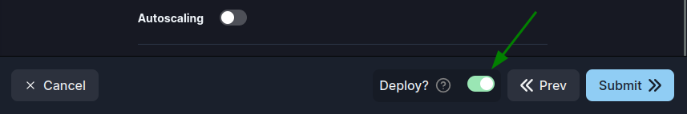
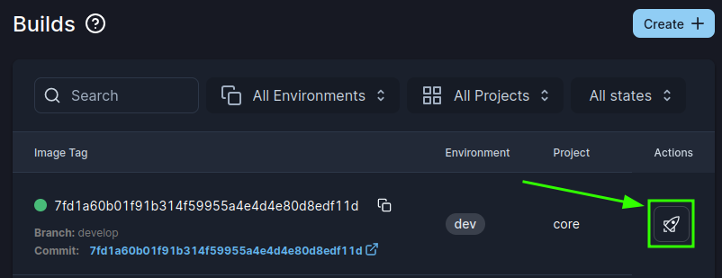

import Zoom from 'react-medium-image-zoom';
import 'react-medium-image-zoom/dist/styles.css';

# Deployment

Un **Deployment** en SleakOps significa la instalación de una nueva versión de tu aplicación. Esto involucra tres componentes principales, que conforman un Helm Release:
- [Releases](/docs/project/deployment/release): Son combinaciones versionadas de tus [Workloads](/docs/project/workload) incluyendo WebServices, Workers, CronJobs y Hooks.
- Build Image: Representado por un [Build](/docs/project/build).
- Configuration Values: Estos comprenden recursos como [Volumes](/docs/project/volumes) y [VariableGroups](/docs/project/vargroup).

:::info

Cuando haya una actualización de cualquiera de estos recursos que no se desplegó inmediatamente, SleakOps la encola como un [cambio pendiente](/docs/project/deployment/pending_changes) y muestra un badge **Publish** en el entorno.

:::

## Desplegando tu ProjectEnv

Al crear un Deployment, obtenemos la imagen correspondiente al Build que se va a desplegar. Antes de esto, ejecutamos el Helm Release en el namespace del clúster adecuado. Este release de Helm incluye los servicios de Kubernetes necesarios, ingresses, workers y otros servicios.

Existen varios métodos para generar un Deployment. Estos se describen a continuación. Ten en cuenta que forzamos ciertos Deployments. Para más detalles, consulta [Más sobre Deployment](/docs/project/deployment/more_on_deployment#forced-deployments).

- [Workloads](/docs/project/workload): Proporciona un conmutador que te permite decidir si ejecutar un nuevo Deployment.
- [VariableGroup](/docs/project/vargroup): Funciona de manera similar a las Cargas de Trabajo, pero no crea un nuevo Release. En su lugar, solo actualiza los [valores](https://helm.sh/docs/chart_best_practices/values/) del Deployment.
- [Dependency](/docs/project/dependency): Desencadena un Deployment automáticamente. Profundiza más sobre esto en [Más sobre Deployment](/docs/project/deployment/more_on_deployment).

<Zoom overlayBgColorEnd="rgba(255, 255, 255, 0.8)">
  
</Zoom>

### Deployment Manual

Si no realizas el deployment de tus cambios inmediatamente, o si tu modificación no fuerza un deployment, tienes tres métodos para ejecutar un Deployment:

- [Build section](/docs/project/build): Usando el botón Deploy, puedes determinar qué Build desplegar.
<Zoom overlayBgColorEnd="rgba(255, 255, 255, 0.8)">
  
</Zoom>

#### Cambios pendientes

- **Badge Publish**: los entornos con contenido pendiente que aún no se desplegó en el clúster muestran un badge **Publish** en la lista de Projects, el dashboard del Project y la lista de Deployments. Hacer clic en él abre el detalle del deployment pendiente, donde revisas los cambios acumulados y los publicas. Ver [Cambios Pendientes y Publicación](/docs/project/deployment/pending_changes).

- A través del [CLI ](/docs/cli).

## Cancelar un Deployment

Usa **Cancel Deploy**, en la lista de Deployments o en el detalle del deployment, para detener un deployment encolado (**Initial**) o en curso (**Creating**). Los usuarios viewer no pueden cancelar deployments.

- **Encolado**: el deployment se elimina antes de llegar al clúster.
- **En curso**: una confirmación te pide confirmar con **Cancel deployment**. Cancelar no garantiza que los hooks no se hayan ejecutado ni que la versión no esté ya aplicada en el clúster, por lo que SleakOps revisa el clúster antes de decidir el estado final:
  - Si el deploy ya terminó correctamente, queda en **Created**.
  - Si no, queda en **Error**, con un mensaje que empieza con "Cancelled by user" e indica qué pasó: el deploy ya había fallado, no se pudo confirmar su resultado, o se detuvo mientras corría y el release volvió a su versión anterior. Un primer deployment no tiene versión anterior, así que se detiene sin rollback.

En todos los casos, los deployments encolados detrás del cancelado continúan.
