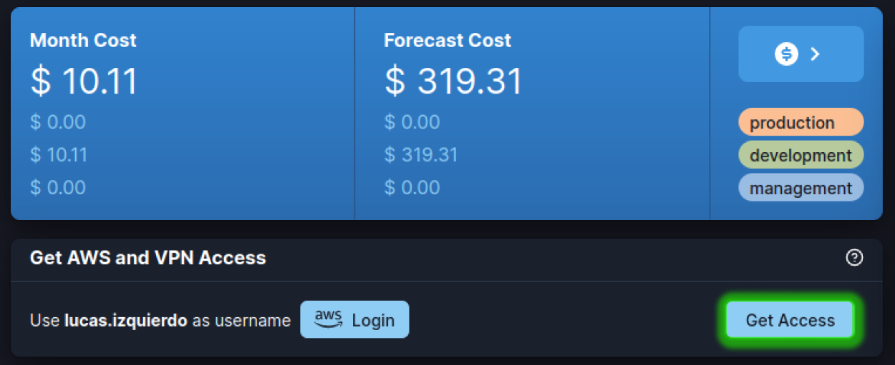
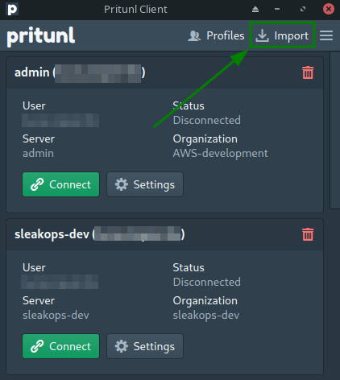

import Zoom from "react-medium-image-zoom";
import "react-medium-image-zoom/dist/styles.css";
import { FiExternalLink } from "react-icons/fi";

# Conexión a la VPN

Para manejar las conexiones VPN utilizamos Pritunl. Puedes descargar el cliente [aquí](https://client.pritunl.com/#install).

<Zoom overlayBgColorEnd="rgba(255, 255, 255, 0.8)">
  
</Zoom>

Una vez que hayas creado un [Proveedor](/docs/provider), ve al [Panel de SleakOps](https://console.sleakops.com/) y selecciona la cuenta para la cual quieres obtener acceso VPN. Recuerda que para hacer esto, necesitas tener acceso a la VPN de esa cuenta, pero la VPN también debe estar creada. Creamos la VPN de una cuenta específica cuando se crea el primer clúster de esa cuenta.

<Zoom overlayBgColorEnd="rgba(255, 255, 255, 0.8)">
  
</Zoom>

<Zoom overlayBgColorEnd="rgba(255, 255, 255, 0.8)">
  
</Zoom>

Esto te mostrará lo que se denomina perfil URI. Tiene un período de validación de 24 horas, y debes cargarlo en el cliente Pritunl.

<Zoom overlayBgColorEnd="rgba(255, 255, 255, 0.8)">
  
</Zoom>

Cópialo e impórtalo en el cliente Pritunl, y podrás conectarte:

<Zoom overlayBgColorEnd="rgba(255, 255, 255, 0.8)">
  
</Zoom>

<Zoom overlayBgColorEnd="rgba(255, 255, 255, 0.8)">
  
</Zoom>

<Zoom overlayBgColorEnd="rgba(255, 255, 255, 0.8)">
  
</Zoom>

:::tip
Si tu cuenta usa la nueva VPN (V2) y el cliente Pritunl no puede importar el perfil, puede que la red desde la que te conectas no tenga permitido llegar al servidor VPN. Un administrador puede permitirla en **Allowed IPs for port 443** (ver más abajo).
:::

## Configura tu VPN

Los administradores pueden cambiar cómo funciona la VPN de cada cuenta desde su página **VPN settings**. Puedes abrirla desde cualquiera de estos lugares:

- **Providers** → **Accounts & Networking** del proveedor → **VPN settings** en la cuenta.
- El nodo **VPN server** del diagrama de red de la cuenta, en la misma página.
- **Manage VPN settings for this account**, en el paso de la VPN de la página de acceso de un Clúster.

Solo los administradores pueden abrir esta página.

Estos ajustes están disponibles con la nueva VPN (V2), y el botón **VPN settings** solo aparece en las cuentas que la tienen. Las cuentas nuevas la tienen desde el inicio. Si una cuenta todavía usa la VPN anterior, ejecuta la migración **VPN V2: Improved Reliability, Security and Management** desde **Upgrades**. Crea la nueva VPN junto a la actual, así nadie pierde el acceso mientras cambias. Cuando termina, cada usuario de la VPN descarga e importa el perfil nuevo. La migración también copia a la nueva VPN los ajustes y las rutas que cambiaste en la anterior. Las rutas a las redes de tus otras cuentas no se copian: la migración te avisa cuáles quedaron afuera, y puedes agregarlas en **VPN settings** si los usuarios las necesitan. Si no puede, te avisa y la nueva VPN queda con sus ajustes por defecto: revísalos en **VPN settings**. Una actualización posterior, **VPN V2: Retire the Previous VPN Server**, retira el servidor anterior: los perfiles creados antes dejan de funcionar.

### Ajustes del servidor

El formulario muestra los ajustes que la mayoría de las cuentas cambia: **DNS servers** (entre 1 y 4, en orden de preferencia), **Search domain**, **Traffic between users**, **Require a one-time code (MFA)**, **Max connected users**, **Several devices per user**, **Max devices per user**, **Session timeout (seconds)**, **Inactive timeout (seconds)** y **Message before connecting**. Cada campo muestra debajo su rango permitido.

### Advanced (JSON)

La sección **Advanced (JSON)** muestra todos los ajustes editables del servidor como JSON, como el editor de servidor de Pritunl, para que puedas cambiar los que el formulario no muestra: **DNS mapping**, **Block outside DNS**, **Restrict routes**, **MSS fix**, **Jumbo frames**, **LZO compression**, **IPv6**, **IPv6 firewall**, los ajustes de ping (**Ping interval**, **Ping timeout**, **Link ping interval** y **Link ping timeout**), **Allowed devices**, **Encryption cipher**, **Hash algorithm** y **Debug logging**. También lista los demás ajustes del servidor de Pritunl que SleakOps no tiene en el formulario, como **route_dns** o **geo_sort**. SleakOps comprueba que cada valor nuevo sea del mismo tipo que el actual.

Edita el JSON y haz clic en **Apply JSON**. Los valores pasan al formulario y la VPN no cambia hasta que haces clic en **Save server and routes**. Si un valor no es válido, o el JSON incluye un ajuste que no se puede cambiar, SleakOps lista lo que está mal y no aplica nada. **Ping timeout** debe ser como mínimo el intervalo de ping más 5.

SleakOps no puede saber si uno de esos otros ajustes de Pritunl cambia los perfiles de la VPN. Antes de guardar uno, revísalo en la documentación de Pritunl: SleakOps te pide confirmar que lo hiciste y, si afecta a los perfiles, cada usuario tiene que importar el suyo de nuevo. Los ajustes que gestiona SleakOps y los que solo informan el estado del servidor no se pueden editar.

Los valores que aparecen bajo **Managed by SleakOps** se muestran como referencia y no se pueden cambiar: **Client network**, **Port**, **Protocol**, **Network mode**, **VXLAN**, **Groups**, **DH parameter size (bits)**, **WireGuard** y **Replicas**.

:::warning Cada usuario vuelve a importar su perfil
**Encryption cipher**, **Hash algorithm**, **IPv6**, **IPv6 firewall** y **Allowed devices** forman parte del perfil VPN de cada usuario. Al cambiar alguno, SleakOps te pide confirmar que cada usuario debe volver a importar su perfil: hasta que lo haga, su perfil actual puede no conectar.
:::

Las credenciales de administrador de Pritunl nunca se muestran en SleakOps. Se guardan en AWS Secrets Manager, en la propia cuenta, en el secreto cuyo nombre contiene `pritunl-v2-secret`.

### Rutas

Las rutas son las redes a las que llegan los usuarios de la VPN. Puedes agregar una red (IPv4 en notación CIDR, por ejemplo `192.168.50.0/24`), quitarla y activar o desactivar su **NAT**. Activa NAT cuando la red de destino no tiene una ruta de vuelta hacia los clientes de la VPN. No se permite una ruta por defecto (`0.0.0.0/0`).

Las rutas marcadas como **Managed** no se pueden cambiar ni quitar: cubren la red propia de la cuenta, la red de los clientes de la VPN y los servidores DNS. Para cambiar las rutas de DNS, cambia los **DNS servers**. Una VPN nueva solo llega a la red propia de la cuenta. Agrega las redes de otras cuentas o las tuyas si los usuarios las necesitan. Esto también vale para la **Cuenta de Management**: su red está conectada con tus otras cuentas, pero su VPN solo llega a ellas después de que agregues sus redes aquí.

:::warning
**Save server and routes** reinicia el servidor VPN una vez. Los usuarios conectados se desconectan alrededor de un minuto y su cliente Pritunl se reconecta solo. El corte dura más o menos lo que el **Ping timeout** (60 segundos por defecto): un valor más bajo lo acorta.
:::

### IPs permitidas para el puerto 443

El puerto 443 del servidor VPN está cerrado por defecto, salvo para SleakOps. Agrega los rangos de IP de quienes importan su perfil desde el enlace, porque su cliente Pritunl lo descarga desde este puerto. Una vez conectado a la VPN, la interfaz web está disponible en la dirección privada de la VPN, así que no necesita rangos. Usa `0.0.0.0/0` solo para abrirlo a todos. Guardar esto no desconecta a nadie.

Ingresa los rangos en **Allowed ranges** (IPv4 en notación CIDR, por ejemplo `203.0.113.0/24`) y haz clic en **Save allowed IPs**. El cambio tarda uno o dos minutos en aplicarse.
