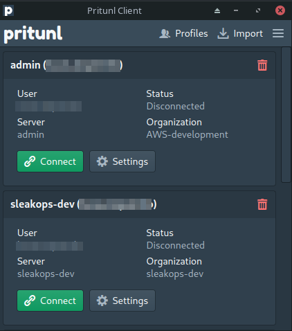
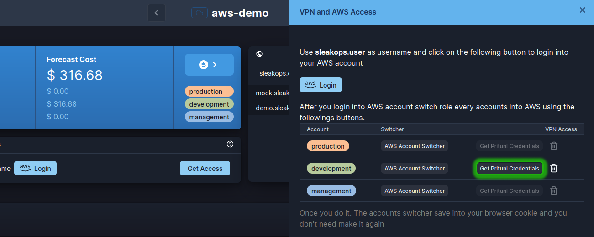
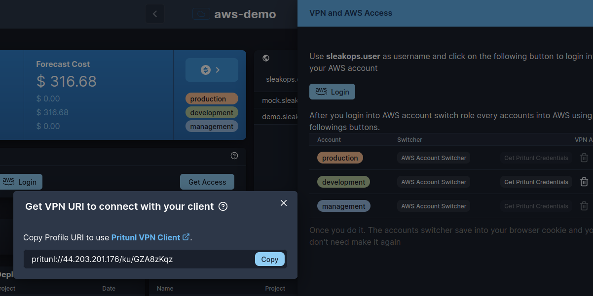
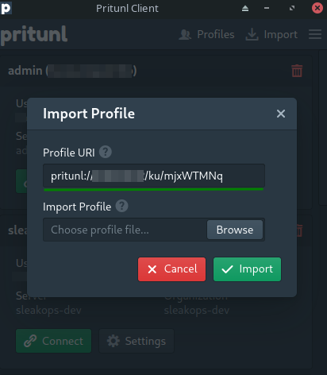
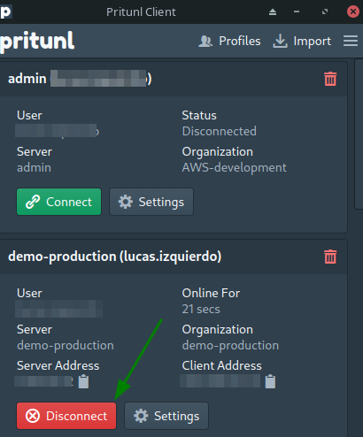

import Zoom from "react-medium-image-zoom";
import "react-medium-image-zoom/dist/styles.css";
import { FiExternalLink } from "react-icons/fi";

# Conexión a la VPN

Para manejar las conexiones VPN utilizamos Pritunl. Puedes descargar el cliente [aquí](https://client.pritunl.com/#install).

<Zoom overlayBgColorEnd="rgba(255, 255, 255, 0.8)">
  
</Zoom>

Una vez que hayas creado un [Proveedor](/docs/provider), ve al [Panel de SleakOps](https://console.sleakops.com/) y selecciona la cuenta para la cual quieres obtener acceso VPN. Recuerda que para hacer esto, necesitas tener acceso a la VPN de esa cuenta, pero la VPN también debe estar creada. Creamos la VPN de una cuenta específica cuando se crea el primer clúster de esa cuenta.

<Zoom overlayBgColorEnd="rgba(255, 255, 255, 0.8)">
  
</Zoom>

<Zoom overlayBgColorEnd="rgba(255, 255, 255, 0.8)">
  
</Zoom>

Esto te mostrará lo que se denomina perfil URI. Tiene un período de validación de 24 horas, y debes cargarlo en el cliente Pritunl.

<Zoom overlayBgColorEnd="rgba(255, 255, 255, 0.8)">
  
</Zoom>

Cópialo e impórtalo en el cliente Pritunl, y podrás conectarte:

<Zoom overlayBgColorEnd="rgba(255, 255, 255, 0.8)">
  
</Zoom>

<Zoom overlayBgColorEnd="rgba(255, 255, 255, 0.8)">
  
</Zoom>

<Zoom overlayBgColorEnd="rgba(255, 255, 255, 0.8)">
  
</Zoom>

:::tip
Si el cliente Pritunl no puede importar el perfil, puede que su red no tenga permitido llegar al servidor VPN. Un administrador puede permitirla en **Allowed IPs for importing VPN profiles** (ver más abajo).
:::

## Configura tu VPN

Los administradores pueden cambiar cómo funciona la VPN de cada cuenta. Ve a **Providers**, abre **Accounts & Networking** del proveedor y haz clic en **VPN settings** en la cuenta. Los administradores también encuentran el enlace **Manage VPN settings for this account** en el paso de la VPN de la página de acceso de un Clúster.

Estos ajustes están disponibles con la nueva VPN (V2). Las cuentas que se crean ahora la tienen desde el inicio. Si una cuenta todavía usa la VPN anterior, el panel muestra un aviso: ejecuta la migración **VPN V2: Improved Reliability, Security and Management** desde **Upgrades**. Crea la nueva VPN junto a la actual, así nadie pierde el acceso mientras cambias.

### Servidor

| **Ajuste** | **Descripción** |
| --- | --- |
| **DNS servers** | Servidores DNS que reciben los clientes de la VPN, en orden de preferencia. Sin ninguno, los clientes usan los suyos. |
| **Require a one-time code (MFA) to connect** | Los usuarios deben ingresar un código de un solo uso cada vez que se conectan. |
| **Inactive timeout (seconds)** | Desconecta a los usuarios inactivos. `0` los mantiene conectados. |
| **Max devices per user** | Cuántos dispositivos puede conectar cada usuario a la vez. `0` significa sin límite. |
| **Search domain** (Advanced) | Se agrega a los nombres de host cortos, para que los usuarios lleguen a `db` en lugar de `db.internal`. |
| **Session timeout (seconds)** (Advanced) | Termina cada sesión pasado ese tiempo, esté activa o no. `0` significa sin límite. |
| **MSS fix** (Advanced) | Limita el tamaño de los segmentos TCP para evitar conexiones que se cuelgan en redes con un MTU pequeño. Déjalo vacío salvo que veas ese problema. |

El puerto del servidor lo administra SleakOps y no se puede cambiar.

### Rutas

Las rutas son las redes a las que llegan los usuarios de la VPN. Puedes agregar una red (IPv4 en notación CIDR, por ejemplo `192.168.50.0/24`), quitarla y activar o desactivar su **NAT**. Activa NAT cuando la red de destino no tiene una ruta de vuelta hacia los clientes de la VPN. Las rutas marcadas como **Managed** dan acceso a la red de la cuenta: las mantiene SleakOps, así que no se pueden cambiar ni quitar.

:::warning
**Save server and routes** reinicia el servidor VPN una vez. Los usuarios conectados se desconectan unos segundos y su cliente Pritunl se reconecta solo.
:::

### IPs permitidas para importar perfiles de VPN

Por defecto solo SleakOps puede llegar al puerto 443 del servidor VPN, y el cliente Pritunl de cada usuario necesita llegar a él para importar su perfil. Agrega los rangos de tu oficina en **Allowed ranges** (IPv4 en notación CIDR, por ejemplo `203.0.113.0/24`), o `0.0.0.0/0` para abrirlo a todos. La conexión VPN en sí no usa este puerto.

**Save allowed IPs** no desconecta a nadie. El cambio tarda unos minutos en aplicarse.
